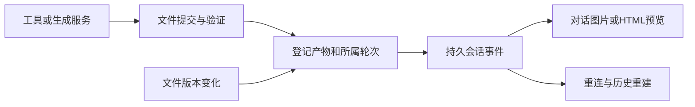

# 对话产物、预览刷新与工具执行调研（2026-10-16）

> 本文保留首次调研时点的证据与建议；后续已按P0-A → P0-B → P1实施，最新功能、宿主工具目录及浏览器验收见[迭代记录](chat-artifact-iteration-2026-10-16.md)。以下“尚未实现”均指首次调研时点。

## 结论与交付边界

用户指出的使用问题成立。Easel 已经有文件保存、媒体服务、部分 Markdown 图片和内容库 HTML 预览，但缺少贯穿执行器与聊天页的**结构化产物交付契约**。现在依赖模型在最终文字里写出可解析路径；文件已生成、工具执行成功和聊天页可见是三个不同事实。

建议保留 OpenClaw/Codex 双执行路径，先补齐“工具执行 → 文件验证/登记 → 持久会话事件 → 对话预览 → 版本刷新”，再评估更大的 Harness 改造。切换多模态模型有助于审图，但不会自动注册生图工具，也不会修复聊天交付与刷新。

**本轮完成调查与可实施方案，尚未实现下述新接口、工具或界面。** 未调用付费模型/图片接口，未重发原任务，未重启或部署138，未修改浏览器消息或 localStorage。历史任务、ClawHub与骨架屏等未完成项继续保留。

## 当前证据与具体断点

本机基于 `df854550fd1ae5142428c7caab75a76007ee3b06` 加当前工作区取证；工作区存在此前预算任务的未提交修改，未混入本轮文档提交。138运行代码与本机分开检查，不把本机新能力当成已发布能力。

| 用户现象 | 已核实的路径 | 判断 |
| --- | --- | --- |
| 图片不能稳定出现在聊天里 | [`ChatMessage`](../web/frontend/src/lib/store.ts)只有正文和请求附件等，没有生成产物集合；[`linkifyOutputs`](../web/frontend/src/lib/linkifyOutputs.ts)靠路径/Markdown改写。裸图片路径可转内联，已有普通图片链接仍是链接；代码块中的路径不会作为交付。 | 已有部分内联能力，但交付依赖模型文字格式，不能保证真实生成的文件出现。 |
| HTML必须跳出去 | [`OutputMessageContent`](../web/frontend/src/components/OutputMessageContent.tsx)渲染清洗后的Markdown；HTML路径转内容库入口。实际iframe在[`OutputsPage`](../web/frontend/src/components/OutputsPage.tsx)，没有复用到消息内。 | 预览能力存在，聊天没有结构化入口和内嵌容器。应复用安全预览，不能移除Markdown清洗或把生成HTML插进主DOM。 |
| 点刷新仍是旧内容 | 聊天的“重新检查文件”只重新请求 `/api/output-status`；它遍历 `a[href]`，不检查 `img[src]`，不改变图片URL。内容库图片URL无版本；HTML虽附 `mtime`，刷新目录只更新 `roots`，不会替换已打开的 `selected` 快照。 | 存在性复查、目录刷新与内容刷新没有统一。HTML主文件与依赖图片/CSS也需共同失效。 |
| 工具生成了文件却没有交付 | [`GatewayAgentProc`](../easel/gateway_agent.py)最终结果只拼接 `payloads[].text`；[`web/app.py`](../web/app.py)的canonical收尾同样只取text。工具回调进入execution记录，未转产物消息。 | 适配层没有把非文字结果归一成聊天产物。具体供应商媒体字段须按实际协议映射，不能臆造字段。 |
| 后台回写后网页不出现 | 原会话的交付与模型更新已落OpenClaw事件276/277，Web最近轮次快照/浏览器消息列表没有自动同步。 | `chat.inject`成功只证明后台历史写入；缺服务端统一消息投影、增量游标和冷启动恢复。 |
| “无法调用工具生成” | 138原会话当前278条事件，实际106次toolCall及106条对应toolResult：read29、exec58、write13、web_search3、edit2、process1。标记失败的结果为read2、web_search3。 | 不能归因为运行器完全不会调工具；应逐次区分工具未注册、未选择、执行失败、落盘失败与交付丢失。未标isError也不等同文件质量合格。 |

138只读复核还确认：

- 原8图接手成品、HTML和ZIP仍存在；抽查第1图474654字节、HTML18697字节、ZIP18377493字节。此前8图完整视觉/媒体核验见[接手复盘](138-image-card-recovery-2026-10-16.md)，本轮未重新做整套浏览器验收。
- 原记录中 `ai_image.py check` 1次，`ai_image.py text2img/img2img/variations` 0次。原模型制作卡片走HTML/Chromium，不是已经调用图片模型后画质差；后来的真实AI素材由直接接手流程补齐。
- 当前主模型和看图模型均为 `openai/deepseek-v4.1-flash`，备用列表为空。`imageModel`是看图路径，不是生图工具注册。
- 配置 `tools.toolSearch=false` 本身不等于禁止工具：该部署采用直接schema兼容路径。本轮没有对当前运行器完整工具目录进行新的实时探测，历史调用列表也不作为当前完整目录。

## Codex应借鉴什么

依据本轮实际打开的[官方OpenAI Docs：Codex App Server](https://learn.chatgpt.com/docs/app-server)。文档是当前在线协议，Easel固定版本CLI是否支持具体能力仍要探测，不能直接假设全部存在。

1. **Thread → Turn → Item，结构化事件独立于正文。** `commandExecution`、`fileChange`、`mcpToolCall`、`dynamicToolCall`各有身份和状态。`item/started`表示开始，`item/completed`才是权威完成态。文件/工具结果不应压扁成一条“正在执行”文案。
2. **工具要有真实执行端。** 实验性 `dynamicTools`在 `thread/start`声明；收到 `item/tool/call`后，宿主实际执行并答复content items，最后形成completed item。写一段SKILL说明并不等于完成工具注册和执行适配。
3. **文件更新是独立能力。** 文档列出 `fs/getMetadata`、`fs/watch`/`fs/unwatch`及 `fs/changed`通知；界面可以订阅已展示文件，失效后重新读取。监听不可用时才用有界轮询，不因刷新再次请求模型。
4. **历史可重建。** `thread/read`及分页turn/item读取支持重新投影；UI应以稳定ID去重并补游标，不把浏览器缓存作为唯一历史。

本机 [`codex_service.py`](../easel/codex_service.py)已经保存item并投影execution，比纯字符串路径更完整；但尚未建立统一产物集合，`_request`支持列表也没有 `item/tool/call`。若未来采用动态产物工具，需要补宿主handler；这不表示已有Codex内置命令/MCP都不能工作。`codex_client.py`当前按thread路由消息，接全局文件watch时也需设计订阅分发。

**证据边界**：`imageView`只证明Agent调用了看图工具，不能当作用户收到生成图片。官方App Server文档没有在本轮证明“任意HTML自动内嵌并热刷新”；这仍是Easel客户端要实现的产品能力。

## DeepSeek Harness的实现更接近这次需求

固定源码提交：`86a402200d95fecef4529d969836f1fe13c6cb0d`。以下为源码/测试阅读，不是安装运行DSH后的验收；它仍处于developer preview，不建议整套替换内核。

| 机制 | 实际源码行为 | Easel可采用的部分 |
| --- | --- | --- |
| 独立交付工具 | [`tool-present`](https://github.com/deepseek-ai/deepseek-harness/blob/86a402200d95fecef4529d969836f1fe13c6cb0d/packages/deliverables/tool-present/src/index.ts)要求所属Agent Session和open turn；校验文件路径、存在性、regular file；工具成功后才append `deliverables/presented {turn,callId,files}`。 | 增加独立 `present_artifact` 契约；即使最终回复为空/被截断，已成功交付的文件仍能恢复。`present`交付现有文件，本身不生成图片。 |
| 会话内文件卡片 | [`PresentedFileCard`](https://github.com/deepseek-ai/deepseek-harness/blob/86a402200d95fecef4529d969836f1fe13c6cb0d/packages/client/ui-deliverables/src/client/PresentedFileCard.tsx)有文件身份、预览入口和独立操作；[`presented.ts`](https://github.com/deepseek-ai/deepseek-harness/blob/86a402200d95fecef4529d969836f1fe13c6cb0d/packages/client/ui-deliverables/src/presented.ts)用session/事件序号/索引定位交付。 | 卡片由持久事件产生，链接从服务端产物身份解析，不让模型编造可访问URL。DSH卡片主要打开侧栏，不能描述为所有内容默认内嵌聊天。 |
| 文件版本与失效 | [`workspace-files`](https://github.com/deepseek-ai/deepseek-harness/blob/86a402200d95fecef4529d969836f1fe13c6cb0d/packages/api/workspace-files/src/index.ts)提供带version的字节读取、metadata与follow；[`face.ts`](https://github.com/deepseek-ai/deepseek-harness/blob/86a402200d95fecef4529d969836f1fe13c6cb0d/packages/client/ui-sidebar-documentpreview/src/client/face.ts)管理读取代次、版本、重载和资源组。 | 显示版本与读取版本绑定；过期响应不能覆盖新版本，依赖变化也要触发失效。 |
| HTML独立浏览上下文 | [`HtmlBody`](https://github.com/deepseek-ai/deepseek-harness/blob/86a402200d95fecef4529d969836f1fe13c6cb0d/packages/client/ui-sidebar-documentpreview/src/client/html/HtmlBody.tsx)有静态sandbox与交互sandbox两种模式；交互模式读取关联资源，打包Blob；数据变化后更换URL和iframe key并回收旧资源。 | 聊天内HTML可用独立预览组件；保持sandbox，不给主应用同源权限，明确支持的关联资源与失败状态。 |
| 图片内容生命周期 | [`ImageBody`](https://github.com/deepseek-ai/deepseek-harness/blob/86a402200d95fecef4529d969836f1fe13c6cb0d/packages/client/ui-sidebar-documentpreview/src/client/image/ImageBody.tsx)以读取字节生成Blob URL，数据变化替换并回收旧URL，加载组件随URL重建。 | 用真实版本驱动图片重载，而不是单纯让React重绘原URL。 |
| 交付后的编辑/重开/删除 | [`present.e2e.ts`](https://github.com/deepseek-ai/deepseek-harness/blob/86a402200d95fecef4529d969836f1fe13c6cb0d/apps/web/tests/present.e2e.ts)包含交付源文件修改、页面重载、删除与导出场景。 | 验收实际文件内容和历史恢复，不能只看卡片出现。源码中有这些测试不代表本轮替DSH运行通过。 |

DSH还公开过一次[工具被配置意外禁用的复盘](https://github.com/deepseek-ai/deepseek-harness/blob/86a402200d95fecef4529d969836f1fe13c6cb0d/docs/postmortem/0002-js-expression-disabled-filesystem-tools.md)：工具不在registry中，快照却把 `UNKNOWN_TOOL` 当成正常期望。对我们的启发是：必须验证启动后的真实工具清单和工具成功的语义，构建通过、SKILL已加载或“工具失败卡片与快照一致”都不够。

## 建议的最小实现

### 1. 先定义可持久化的产物身份

新增Artifact registry，关联现有run ledger与execution记录。字段至少包含：

```text
artifactId, sessionId, turnId, toolCallId?, producerRunId?, origin
relativePath, displayName, mimeType, size, version, updatedAt
status: writing | ready | failed | missing
derivedFromArtifactId?, dependencies[], errorCode?
```

- `origin`区分执行器交付、图片生成服务、用户导入和兼容历史链接。生产者必须提供可验证的归属；路径相同不等于同一会话拥有它。
- 服务端解析路径、校验输出根目录/符号链接边界、MIME与实际字节；从登记记录构建URL。不得全盘扫描outputs后把别的会话文件自动挂入当前聊天。
- 同路径覆盖保留artifactId并递增version；优先原子写入/提交后标ready。stat可用于变化检测，发布版本不能只依赖秒级mtime；同大小、短时间覆盖也要能识别。
- 登记及事件持久化使用事务/outbox或同一可恢复写入边界，避免“数据库有卡片、文件未提交”及“文件已登记、SSE丢了后永远找不到”。

### 2. 工具生成、文件交付分工明确

建议先提供三个服务契约，再按执行器支持情况暴露为OpenClaw插件工具、Codex MCP/动态工具或带校验回执的兼容脚本。下列名称是拟议接口，不是已存在工具：

- `present_artifact(files)`：只验证/登记已存在文件，返回真实artifactId/version；无付费模型调用。
- `render_html(sourceArtifactId, options)`：受控Chromium离线渲染并登记派生PNG；与源HTML建立关联，渲染失败保留原文件和错误。
- `generate_image(prompt, referenceArtifactId?, channelId, idempotencyKey)`：实际调用已配置生图服务，记录job与费用边界，成功保存后自动交付到所属turn。

Easel已有 [`POST /api/imagegen`](../web/app.py)，复用共享 `ai_image.py`，无需另造一套供应商协议。应抽成可供Web和Agent共用的服务，补会话归属、持久job、幂等和通道队列；不能让Agent携带管理员Cookie调用内部HTTP。现有 `_IMAGEGEN_JOBS`是进程内字典，不满足重启恢复。请求 `n≤4`只限制每次图片数量，不是跨任务并发控制。

生图队列继续遵守用户给定的通道限制：xjbh同时1个、image.mlgb7最多4个。预览失败/浏览器重连不能再次提交生成；结果未知先查job与已保存文件。不得因看图失败自动切换到昂贵模型。

启动能力回执区分：工具已注册、schema已暴露、执行端可达、离线配置齐全、最近真实调用是否成功。离线检查通过不能写成供应商可用。未暴露某项能力时返回明确原因，不让模型假装已经生成；工具开始、等待、失败、取消与文件ready分别显示。

### 3. 让聊天直接消费产物事件



- 事件至少有 `artifact.created/updated/failed/missing`、稳定eventId和会话游标。OpenClaw与Codex结果保留各自原始证据，归一到同一registry，不改变各自模型执行语义。
- ChatMessage增加产物引用；在所属助手轮次展示图片网格、HTML预览卡或可下载文件。预览可展开到工作面板，但留在原聊天上下文中，不强制切页。
- 先读服务端历史snapshot，再订阅游标后的增量；迟到/重复事件按ID和version合并。后台注入也经过相同投影，刷新网页后可恢复。旧localStorage作为兼容缓存，不能反向覆盖服务端新记录。
- 对旧Markdown只迁移明确引用、实际存在并能核实会话归属的路径；无法确定的只保留可检查的历史链接，不猜造产物。

### 4. 把“刷新”拆成用户能理解的操作

| 操作 | 实际行为 | 是否产生模型费用 |
| --- | --- | --- |
| 刷新预览 | 查询最新metadata，重新读取已保存字节；用version/强制重载代次更新图片和iframe，处理依赖资源、过期请求和加载失败。 | 否 |
| 更新渲染图 | 读取已修改的HTML，在受控浏览器中重新截图并登记新PNG版本。应显示执行进度、错误和源版本。 | 通常无模型费用；需明确本地/远端渲染资源成本 |
| 重新生成 | 用修改后的提示词/参考图提交一个新的生成job，继承原文件关系，保留旧版本。 | 可能；使用已授权渠道与次数/并发约束 |

自动监听只覆盖本会话已登记且当前展示的产物及HTML依赖；卸载/切会话时退订。可先实现metadata有界轮询，再接文件watch；二者都只做失效与读取。HTML继续sandbox隔离，关联资源通过受限解析器打包或版本化代理，不能仅给主HTML加 `?v=`便宣称依赖全刷新。

## 实施顺序与验收

| 阶段 | 最小交付 | 必须验证的结果 |
| --- | --- | --- |
| P0-A：文件进入对话 | registry + present契约 + 后端历史/增量 + ChatMessage产物引用与图片/HTML组件 | 工具交付文件后，即使最终助手正文为空，聊天仍有真实预览；同一个原会话刷新页面可恢复；其他会话文件不串入。 |
| P0-B：刷新真实内容 | version-aware metadata/读取、手动刷新、HTML依赖失效与失败重试 | 同名同大小图片覆盖显示新内容；HTML仅改CSS/图片也可更新；旧异步响应不盖新版本；刷新期间供应商调用数为0。 |
| P1：可靠生成工具 | 提取共用生图服务、执行器注册/handler、持久job/幂等/通道队列、自动交付 | 缺配置与工具未注册准确报错；成功落盘自动显示；重连/超时不重复扣费；xjbh≤1、image.mlgb7≤4。先假供应商隔离验收，真实调用单独记录。 |
| P1：恢复和兼容 | 后台注入统一投影、旧链接迁移、全局watch分发/轮询与历史游标 | 外部交付、断线补流、冷启动与重复事件可对账；文件删除、半写入和访问隔离有真实状态；未知结果不伪装完成。 |

页面验收应覆盖桌面、实际390px、浅/深色、键盘打开/关闭预览与焦点恢复、下载/打开文件/返回原对话。HTTP200、源码测试、模拟生成和真实供应商输出分别留证。当前工作台无管理员登录，不为本次调研新增认证；138既有鉴权不绕过。

## 本轮验证记录

- 只读本机关键源码及138生产适配器/原会话SQLite；106次工具调用与106条结果按message内部toolCall/toolResult重新统计，不以顶层event type误计为0。
- 实际打开OpenAI官方App Server文档，读取DSH固定提交的present、交付UI、图片/HTML预览、版本读取/资源失效及相关测试/复盘；未运行DSH测试。
- `python -m pytest tests/test_artifact_delivery.py -q`：**5 passed**，覆盖既有落盘、路径边界与空文件/失败等行为。
- `node --test tests/linkify-upstream.test.mjs`：**4 passed**，覆盖既有链接改写；这些用例不证明新聊天产物协议已实现。
- 本轮为纯文档，没有重新构建或部署前后端，没有宣称聊天图片/HTML刷新已通过真实浏览器验收。
