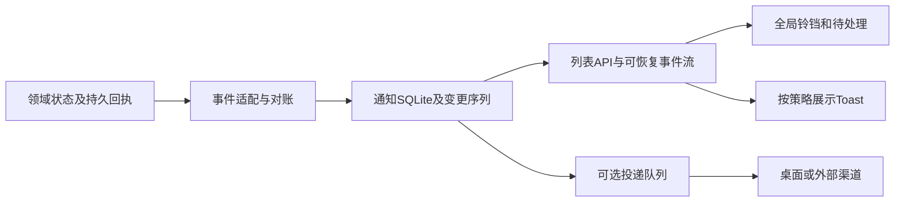

# Easel全局通知事件方案（2026-10-15）

状态：研究与实现方案，尚未实施服务端通知中心。用户要求先给思路与方案；本轮不部署、不发送通知测试，也不启用外部渠道。138等待用户后续上传指令。

## 产品目标与事件选择

用户离开当前页面后，仍能知道后台任务的结果、哪里需要操作，并点击回到准确的任务。建议使用一个全局铃铛入口，连接持久通知列表、即时Toast和可选桌面/外部提醒。三种展示共享事件身份，各有投递策略。

| 事件 | 通知中心 | 即时提醒与落点 |
| --- | --- | --- |
| 对话/Agent完成 | 后台或非当前会话完成记录；当前会话可按偏好静默收录 | 非当前会话Toast，跳指定session/turn及最终结果 |
| 最终失败/中断/超时 | 记录最终状态和可读原因，区分用户主动停止 | 失败提醒；查看该轮回执，不自动重试 |
| 审批、提问、补充输入 | 始终进入“待处理”，直到真实请求解除/失效 | 突出待处理；返回请求卡片，不在通知上绕开原审批 |
| 生图/视频/采集任务完成或失败 | 记录任务/产物ID和最终状态 | 回准确任务或产物；工具中间失败但最终成功不重复报最终失败 |
| 平台发布结果 | 只按平台已确认回执区分成功、失败、待确认 | 跳发布记录/可用作品URL；本地文件ready不等于公开发布 |
| 定时提醒 | 有执行来源和唯一触发ID时接入 | 过期补偿、时区与去重需先实现；现有排期条目不冒充可执行调度器 |
| 服务/网关/模型异常 | 稳定故障及恢复合并更新 | 设置/诊断入口；轮询短抖动不刷屏，已有版本Agent评估不自动升级 |

保存设置、复制、固定会话、打开菜单等即时操作继续用Toast，不进入持久收件箱。流式delta、每次工具开始/结束不作为全局通知。上下文接近预算的提醒可在[容量面板](chat-context-capacity-plan-2026-10-15.md)取得可靠数据后接入。

## 同类产品的一手实现参考

以下来源在2026-10-15按固定提交读取，HTTP200。验证范围是源码和文档，不是运行这些产品或确认其云服务能力。

| 产品/固定提交 | 可借鉴实现 | 不能据此推断 |
| --- | --- | --- |
| OpenHands `e4775b4b` | [Agent通知hook](https://github.com/OpenHands/OpenHands/blob/e4775b4ba61a83ba80af5f7b0b826201b8e8ea05/src/hooks/use-agent-notification.ts)：只在进入完成/等待输入/等待确认的状态变化时提醒，声音默认关闭，处理autoplay拒绝 | 这个hook不能证明具备服务端持久收件箱 |
| Open WebUI `6a18585f` | [通知工具](https://github.com/open-webui/open-webui/blob/6a18585ff4c2e5f6805f682222cfbc46dc669ef8/backend/open_webui/utils/notifications.py)与[认证路由](https://github.com/open-webui/open-webui/blob/6a18585ff4c2e5f6805f682222cfbc46dc669ef8/backend/open_webui/routers/notifications.py)：事件白名单、按用户配置、away/always投递、webhook目标校验及配置脱敏 | 所查模块是渠道能力，不等于完整站内通知收件箱；不自动复制其数据结构 |
| LobeHub `53195fc5` | [数据库schema](https://github.com/lobehub/lobehub/blob/53195fc55bdb295234ab1083054a8c3b220ae963/packages/database/src/schemas/notification.ts)、[收件箱模型](https://github.com/lobehub/lobehub/blob/53195fc55bdb295234ab1083054a8c3b220ae963/packages/database/src/models/notification.ts)：用户/工作区隔离、去重、已读/归档、独立delivery记录 | 不意味着Easel需引入PostgreSQL或所有渠道 |
| LobeHub同提交 | [数量对账](https://github.com/lobehub/lobehub/blob/53195fc55bdb295234ab1083054a8c3b220ae963/apps/server/src/services/notification/inboxCounts.ts)：计数结合真实待处理请求，避免已读掩盖未处理、已失效留下幽灵角标 | 待处理数量不能只count未读通知 |

LobeHub开源树中的[Agent完成hook](https://github.com/lobehub/lobehub/blob/53195fc55bdb295234ab1083054a8c3b220ae963/packages/business-server/src/agent-run/notifyAgentRunCompleted.ts)是空实现，不能写成已验证可用的完整Agent投递链。以上取各自可验证部分：状态触发、渠道策略、持久收件箱与待处理对账。

## 本项目可复用与需补齐部分

- [OpenClaw执行记录](../easel/execution_store.py)、[聊天回执](../web/chat_execution.py)、[Codex运行服务](../easel/codex_service.py)已有会话/轮次、终态和部分可重放事件，可作为领域事件来源；不能以浏览器离开/断线推断任务失败。
- [发布回执](../easel/publish_receipts.py)与[后续核验](../easel/publish_followup.py)区分发布确认、核验与提醒投递，沿用该语义。
- [邮件钩子](../mcp/easel-notify/notify_hook.py)已有可选邮件与非阻断发送；60秒内存去重和守护线程不等于跨重启持久投递，可作为后续渠道适配基础。本轮没有发送邮件。
- [Toast](../web/frontend/src/lib/toast.ts)可继续做短反馈。共享工作区未提交eventNotifications草稿使用sessionStorage、最多100项，动作函数不序列化；它只覆盖当前标签页部分历史，不能代替服务端持久通知、跨标签同步和恢复。
- [服务身份](../easel/server_access.py)放在`scope['easel.operator']`，通知读写和SSE必须使用这个身份及资源归属；不另造公共默认收件人。
- [排期接口](../web/app.py)保存排期数据。接入到期提醒前需落实触发器、时区、过期补偿和唯一触发标识，不能仅从“有排期列表”宣称已支持定时通知。

## 推荐架构

建议新增集中通知服务，SQLite放用户数据目录，接入既有路径、备份和数据位置规则。通知不归某个页面组件所有；页面是否挂载不影响后台记录。SQLite仅承担通知投影/变更记录及后续outbox，不替代全部业务存储。

### 数据模型（拟议）

| 对象 | 关键字段与约束 |
| --- | --- |
| Notification | id、operatorId、workspace/dataScope、eventType、severity、title、boundedBody、createdAt/updatedAt、dedupeKey、sourceEventId、sourceRevision、readAt、archivedAt |
| Target | 类型白名单及sessionId/turnId/requestId/jobId/outputId/receiptId；精确到领域对象，接口再次检查权限；不持久化JS回调 |
| Action projection | requiresAction、resolutionState、resolvedAt及原请求标识；状态来自真实审批/任务，不由已读推导 |
| Change log | operator/dataScope内单调递增seq、notificationId、revision、changeType、时间；creation/update/read/archive/resolution都进入序列 |
| Delivery/outbox | channel、notificationId、dedupeKey、attempt、nextAttemptAt、queued/sent/failed等；仅渠道实际回执才能变更sent，SMTP接受不等于收件人已阅读 |

去重唯一键至少包含operator、数据域和领域event身份；重试创建时更新同一事件，不重新置未读。领域状态修订使用原始revision或版本，晚到的运行中/待审批事件不能覆盖已完成/已解决状态。不要按“相同标题+时间”猜测事件相同。

“已读”只表示看过；“待处理”由真实请求决定。用户点击全部已读，不应解除审批、自动发送答案或使待处理角标消失。归档也不能隐藏尚未解除的待处理请求，至少在待处理区持续可见；过期/取消/任务终结时对账为失效，并禁用原动作。

### 持久化、崩溃恢复和去重

现有运行/发布状态很多保存在JSON，不能与新SQLite通知表共享原子事务。采用“先持久领域结果→有稳定ID的事件/outbox或可重建状态→幂等生成通知→提交游标”的顺序；启动与周期对账补齐中断窗口，保留源回执直到完成对账。对于无法从当前快照重建的短暂审批/状态变化，必须先为源增加持久事件，不承诺凭一次内存回调可靠恢复。

交付语义为至少一次事件投影＋幂等去重；不承诺跨JSON/SQLite/外部邮件的exactly-once。通知写入失败单独记录、稍后补偿，不把已成功的任务改成失败；SQLite不可写时UI显示通知暂不可用，任务主链继续。

首版可以用带游标的轮询完成一致性，后续用统一SSE减少延迟。列表返回在同一读取快照取得的items、counts及highWatermark，客户端从该watermark订阅/补拉，避免“先列表后订阅”漏事件。分页cursor与变更seq各自命名。

事件序列覆盖新增、内容/状态更新、已读、归档及请求解除。客户端按seq/revision幂等合并；断线从最后确认的seq追赶，多标签分别接收但共享服务端已读状态。过期游标显式reset/refetch，不能默默跳到最新；删除/保留策略留下可识别重置边界。SSE不稳定时退回轮询，不要求为此引入另一套WebSocket。

多个浏览器标签可同时看到更新，但声音/桌面提醒应由单一活跃标签或可过期租约协调，优先一次提示；浏览器关闭后，任务仍记录通知。浏览器完全退出时的OS推送需要后续Service Worker/Web Push或外部渠道，页面内SSE不能做到。

### 接口草案与权限

拟议接口：`GET /api/notifications`（分页/筛选/计数/水位）、`GET /api/notifications/events?after=...`、`POST /api/notifications/read`、`POST /api/notifications/archive`。批量已读应带已见watermark，避免读掉请求期间刚到的新通知。待处理动作继续走原审批/任务接口，不增加无权限捷径。

服务器从operator及本项目资源归属推导范围，不接受客户端随意指定其他用户ID。本机无认证模式绑定本地数据实例身份；多用户旧记录若无可信owner，保留未知归属，不广播历史给所有登录用户。列表、计数、SSE、Target跳转都执行相同范围检查。通知只含有界摘要和内部ID，外部地址使用目标白名单/既有URL校验，凭据及完整工具正文不进入通知。

## 入口、交互与打扰策略

全局工具栏保留铃铛：未读显示数字（超出99显示99+），待处理有独立标识和数量，面板分别列“待处理/未读/全部”，同一条通知不会在总数中重复相加。Desktop可用popover/侧抽屉，390px以抽屉显示，列表按游标加载。

每条显示来源图标、标题、短摘要、时间、状态和查看入口；来源可区分Agent/对话、图片/视频、平台发布、系统。颜色之外还有图标和文字。键盘可打开/关闭、移动焦点，Escape恢复入口焦点；更新计数使用合适的live区域，流式输出不持续播报。

点击通知返回它记录的session/turn/job/receipt，不自动跳“任意最新会话”；已删除/无权限目标显示明确状态，并允许看有权限的通知摘要。保留当前草稿、返回路径及既有侧栏规则：首次/刷新两栏折叠；主动点击工具栏“对话”才进入聊天并展开会话列；通知跳转不任意展开会话列，也不覆盖用户点击历史会话的选择。

当前可见会话的普通完成可以静默计入中心；后台完成展示短Toast；审批/最终失败有更高优先级。声音/浏览器通知默认关闭，用户主动启用后才请求权限。权限拒绝不影响站内提醒；仅HTTP可达不能证明Notification API或声音在该环境可用。读取历史/恢复重连不重复弹旧Toast，系统异常按故障周期合并与恢复。

## 分期与可执行验收

| 阶段 | 交付范围 | 核心验收 |
| --- | --- | --- |
| P0 | 通知服务、领域事件身份、SQLite/对账、operator隔离、列表API | 重复事件、晚到修订、任务成功但通知失败、崩溃窗口、重启补偿、跨用户禁止访问 |
| P1 | 铃铛/列表/数量、已读/归档、精确跳转，先轮询再SSE | 列表到订阅竞态、seq追赶/reset、多标签同步、read不解除action、目标失效与草稿保护 |
| P2 | OpenClaw/Codex终态与待交互、生图/视频/发布等适配 | 页面离开/浏览器断线后台仍落库；重放无重复；假published不报成功；审批解除/过期同步 |
| P3 | 提醒偏好、声音/浏览器权限、稳定故障与定时触发 | denied/default/granted、隐藏页/多标签一次提醒、静音、时区与过期补偿 |
| P4 | 邮件/Webhook等可选渠道与持久投递回执 | 显式启用后测试；超时重试/去重、配置脱敏、失效目标及发送失败独立可见 |

第一批建议只做P0/P1，并接入聊天完成/最终失败/待交互三个真实来源形成可验链路；随后接媒体/发布。产品呈现与领域适配可分步，但必须由后台持久真相驱动，不能把所有Toast都当通知保存。

实施后分别记录临时数据/模拟检查、真实HTTP、真实后台事件和用户页面验收。真实页面要覆盖所有通知Target、铃铛菜单、设置入口、键盘与390px；未经检查不标通过。本轮仅源码研究与文档，未新增认证、发送模型/邮件/桌面通知、构建或发布新包。内容库封面/数量、办公室返回对话和其他既有未验事项继续保留在[需求清单](user-requirements-2026-10-08.md)。
